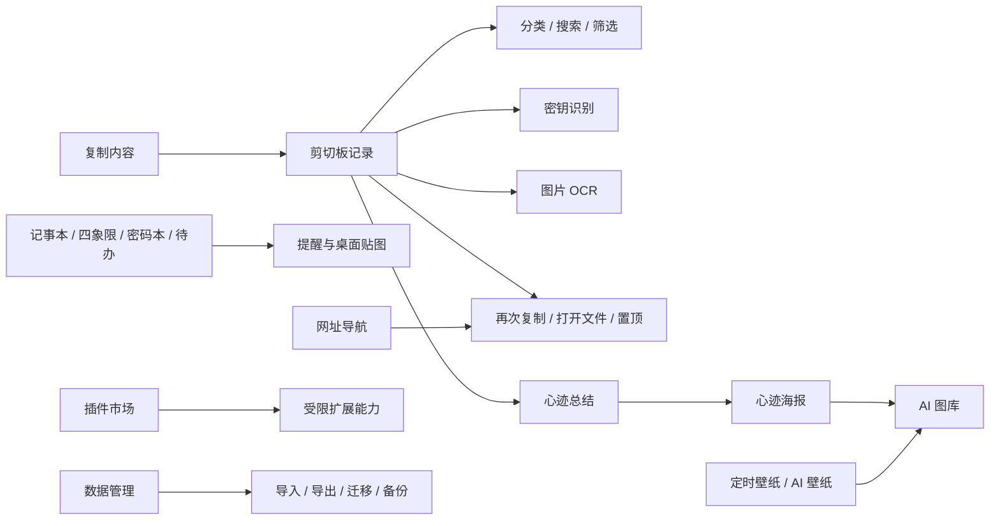

  
   
  扫码添加开发者微信，反馈问题、交流需求或进群。

# Gleanx

> 把复制、整理、回看、提醒、插件扩展和生成能力集中在一个 Windows 客户端里。

  

  
  
  
  

Gleanx 是一款面向 Windows 用户的本地效率客户端。它不只是剪切板历史工具，而是把复制记录、图片 OCR、素材整理、心迹海报、记事本、定时任务、网址导航、桌面管理、插件市场和数据备份放到一个统一工作台里。

如果你经常遇到这些问题，Gleanx 可以补上这块能力：

- 复制过的文字、图片、文件、目录和链接很快找不到。
- 截图里有重要文字，但后面无法检索和复用。
- 临时素材散落在聊天、浏览器、桌面和下载目录里。
- 每天做过什么、复制过什么、整理过什么没有沉淀。
- 希望桌面工具能本地优先，同时按需接入 AI、壁纸、网址和插件能力。

## 下载

最新 Windows 客户端请前往：

[Gleanx Releases](https://github.com/dcxa521gi/Gleanx/releases/latest)

当前版本：2.6.0。支持软件内下载、校验和重启安装。[GitCode 备用下载](https://gitcode.com/dcxa521cs/Gleanx/releases)提供同版本安装包、blockmap 和 latest.yml；软件自动回退需启用备用源。已安装早期 2.6.0 测试包的用户请退出软件后手动覆盖安装，版本比较不会提醒同号更新。

## 产品预览

以下图片和动态预览为历史安全示意素材，不包含用户剪切板、桌面文件或私人内容；当前界面以 2.6.0 安装包为准。

  

| 剪切板时间线 | 图片 OCR 与素材整理 |
| --- | --- |
|  |  |

| 工作台聚合 | 心迹与备份 |
| --- | --- |
|  |  |

## 客户端核心功能

| 功能 | 能解决的问题 |
| --- | --- |
| 剪切板记录 | 自动记录文本、图片、音频、视频、代码、文件和目录，避免复制后找不到。 |
| 智能分类 | 按文本、图片、音频、视频、代码、文件、目录和密钥等类型归类，减少手动整理。 |
| 密钥识别 | 识别常见 API Key、GitHub、AWS、Google、Stripe、Slack、JWT 与私钥，避免敏感内容进入普通通知和心迹。 |
| 图片 OCR | 对截图和图片内容进行文字识别，整理出更易读的标题和摘要。 |
| 重复内容合并 | 重复复制同一内容时不反复新增记录，而是前移已有记录并累计复制次数。 |
| 图片查看器 | 图片、心迹海报和设置图片统一在应用内查看，缩放只作用于图片，支持居中和拖拽。 |
| 文件与目录复制 | 剪切板中的文件和目录支持再次复制，目录也可按系统文件列表复制。 |
| 附件打开 | 图片、视频、音频、代码和普通文件可直接打开原文件，原文件失效时使用缓存副本。 |
| 心迹 | 根据每日使用轨迹生成 AI 总结，并支持周、月、年自然周期自动生成。 |
| 心迹海报 | 支持不同回复风格、海报风格、长图查看、复制和下载；品牌、官网、二维码及本人邀请码放在原图下方的可配置融合页脚。 |
| AI 图库 | 集中查看心迹海报、AI 壁纸和节日海报，使用渐进预览降低等待感。 |
| 定时壁纸 | 支持本地壁纸轮换、AI 壁纸生成、图生图、多参考图和定时切换。 |
| 网址导航 | 保存常用网址、整理分类、记录点击、收藏和评论，弥补浏览器收藏夹不够灵活的问题。 |
| 截图与标注 | 按需安装截图工具，选区后进行箭头、文字、画笔和马赛克标注，复制、保存或贴图到桌面。 |
| 功能市场 | 免费、积分或支付宝购买下载安装；提供开发教程、AI 提示与技能包，支持导入本机安全声明式模块。 |
| 记事本 | 支持备忘录、四象限、密码本、待办事项、标签、提醒、加密和桌面贴图，四格分别编辑与展示。 |
| 桌面宠物 | 提供可互动的小拾桌宠，可悬停查看状态、聊天、喂食、洗澡、旅行、购物、抽签和查看运势。 |
| 设备控制中心 | 支持键盘、鼠标和 HID 设备检测，配置快捷键、应用级方案、宏步骤和安全暂停。 |
| 插件市场 | 支持已拥有插件优先展示、分类筛选、账号权益同步和受限声明式插件能力。 |
| 邀请好友 | 支持邀请码、邀请记录和软件通知同步，邀请码长度以当前配置为准。 |
| 个人中心 | 公开编号选号、随机在售推荐、积分/支付宝兑换、里程碑头衔、最多 5 枚勋章、等级经验与账号权益。 |
| 局域网群信 | 双向确认好友、同网聊天与文件、3 人确认建群、成员称谓、剪切板/心迹分享及可关闭的未读提醒；不含跨网络聊天。 |
| 个人 AI 助手 | 词元跳动授权问答与生图，图片放大/滚轮缩放，# 选图、上传与多图参考编辑；不自动发送全部历史。 |
| 软件通知 | 聚合软件公告、积分变化、审核结果、升级提醒和邀请码变化等客户端通知。 |
| 系统优化 | 统一收纳右键菜单、开机启动、定时任务、桌面管理和定时壁纸。 |
| 数据管理 | 支持本地数据导出、导入、迁移、备份、恢复和清理。 |

## Gleanx 2.6.0 更新重点

本次合并 2.6.0 各轮维护，去重并按最终能力整理；2.5.0 原有能力继续保留。

- 全局自然绿折纸 G 标识，轻盈悬停扩展记事本、市场、图库、个人中心和网址导航，改善深浅色及窄窗显示。
- 剪切板按日期、分类、复制次数清理；新增周期/定时自动清理。缓存释放与可信原文件移入系统回收站分别选择，原文件默认不动。
- 网址真实 GET 与正文判断，疑似错误/停放/验证页标记需确认，避免仅凭 200 误判。
- “备忘录”升级为“记事本”，加入待办和四格四象限卡片、统一类型标签。
- 独立公开 ID 选号、随机在售推荐、积分/支付宝兑换；新增装饰性里程碑头衔，最多佩戴 5 枚有效勋章。
- 新增局域网群信：好友确认、同网聊天/文件、3 人确认建群、任务/待办接受与分享，独立窗口及可关闭未读提醒。
- 个人 TokenDance 助手独立问答/生图、一次授权可撤销，支持原图查看、滚轮缩放、# 选图与上传多参考图。
- 修复设置卡顿、数据目录错位、登录无反应和凭据落盘问题；磁盘不可用时不切换空目录，不自动合并或删除旧副本。
- 数据管理按范围预览/强制清除记录、缓存、贴图、心迹和记事本；账号、积分、订单、授权等仍保留。关闭站内信提醒提交已读，失败保留未读。
- 最终版本已移除跨网络私聊、外部群和官方群；保留 LAN 与个人助手，不增加聊天内容服务器中转。

图生图需要支持参考图协议的 TokenDance 模型和可用额度。早期同号测试包需备份并完全退出托盘后覆盖安装；安装器未签名。真实第三方授权/付费生图、支付及物理多机 LAN 仍需实际环境验收。完整客户端说明见 [2.6.0 Release](https://github.com/dcxa521gi/Gleanx/releases/tag/Gleanxv2.6.0)。

## 典型使用场景

### 1. 复制内容太多，事后找不到

Gleanx 会自动记录复制过的文本、图片、链接、文件和目录，并按时间线展示。你可以通过搜索、类型筛选、日期筛选快速找回内容。

### 2. 截图里有文字，但标题很乱

图片进入剪切板后，Gleanx 会尝试 OCR 识别并整理标题、摘要，让截图不只是一个图片文件，而是可以被搜索和回看的内容。

### 3. 每天工作很多，但没有沉淀

心迹功能会基于当天轨迹生成总结和海报，让复制、整理、浏览过的内容形成每日回顾。

### 4. 想要扩展能力，但不想让插件乱执行

插件市场以账号权益、分类展示和受限能力清单为基础。插件可以扩展功能入口、复制、外链和壁纸切换等能力，但客户端不会执行插件包里的任意脚本。

### 5. 不想把隐私内容到处上传

Gleanx 优先以本地保存为中心。本地数据支持备份、迁移和恢复，适合希望把个人效率资料掌握在自己设备上的用户。

## 功能结构

## 适合谁使用

- 经常处理大量复制内容、截图、链接、文件和目录的 Windows 用户。
- 需要把工作素材、灵感和日常记录沉淀下来的人。
- 希望本地优先，不想把所有私人内容交给在线工具的人。
- 喜欢一个轻量桌面工作台，而不是在多个小工具之间来回切换的人。

## 作者与联系

- 作者：来日方长
- 开发者微信：`Sugar_hyl`

  
   
  扫码添加开发者微信，反馈问题、交流需求或进群。

